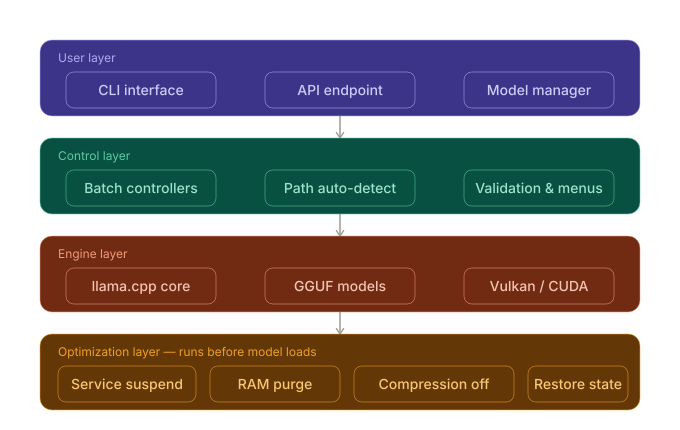
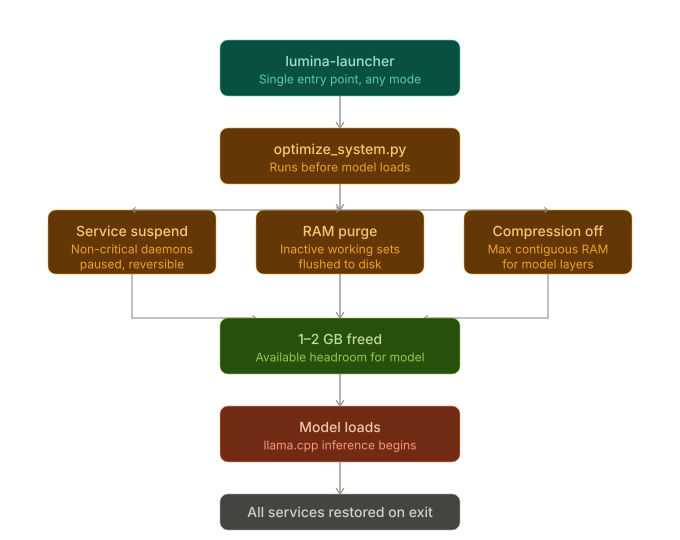
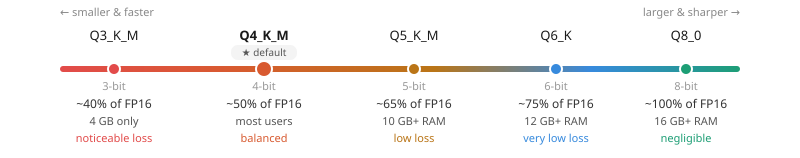

<div align="center">

# Lumina Edge

### Run powerful AI models locally, on hardware you already own.

[](https://github.com/Parth-debug-cse/Lumina-Edge)
[](https://github.com/Parth-debug-cse/Lumina-Edge)
[](https://github.com/Parth-debug-cse/Lumina-Edge)
[](https://github.com/Aider-AI/aider)
<br/>

**[Quick Start](#quick-start) · [API](#openai-compatible-api) · [Features](#features) · [Benchmarks](#benchmarks) · [Roadmap](#roadmap)**

</div>

---

## The Problem with Local AI Today

You have a normal laptop. You want to run a local LLM — for privacy, offline access, zero API cost. The hardware is capable, the models exist, the tooling is the problem.

Lumina Edge is built for that user. It uses `llama.cpp` on Linux/Windows and Apple's native **MLX framework** on Apple Silicon, with configurable local model serving and memory controls. Operating-system cache reclamation is best-effort, may require elevated privileges, and is not guaranteed to free a fixed amount of RAM; performance depends on the model, runtime build, and hardware. Use the benchmark tooling below to measure a specific setup rather than relying on advertised speedup claims.

---

## Architecture



---

## Quick Start

```bash
git clone https://github.com/Parth-debug-cse/Lumina-Edge.git
cd Lumina-Edge
```

| OS | Requirements |
|----|-------------|
| Windows | Node.js 22.12+, Python 3.10+, [Vulkan Runtime](https://vulkan.lunarg.com/) |
| Linux | Python 3.10+, Node.js 22.12+, cmake, build-essential, Vulkan drivers |
| macOS | Python 3.10+, Node.js 22.12+, Xcode CLI tools, Apple Silicon, Homebrew |

Create and activate a virtual environment before installing dependencies (recommended; avoids changing system Python):

```bash
# Linux / macOS
python3 -m venv .venv
source .venv/bin/activate

# Windows PowerShell
# py -m venv .venv
# .venv\Scripts\Activate.ps1

python -m pip install --upgrade pip
```

```bash
# Linux / Windows
python -m pip install -r requirements.txt

# macOS (Apple Silicon)
python -m pip install -r scripts/requirements-macos.txt -r lumina_screen/requirements.txt
```

**Windows / Linux:** download the matching `llama.cpp` release from [ggml-org/llama.cpp](https://github.com/ggml-org/llama.cpp/releases/latest) and extract directly into `bin/` (no subfolders).

| OS | GPU | File |
|----|-----|------|
| Windows | Intel/AMD | `llama-bXXX-bin-win-vulkan-x64.zip` |
| Windows | NVIDIA | `llama-bXXX-bin-win-cuda-cu12.x-x64.zip` |
| Linux | Intel/AMD | `llama-bXXX-bin-ubuntu-vulkan-x64.tar.gz` |
| Linux | NVIDIA | `llama-bXXX-bin-ubuntu-x64-cuda.tar.gz` |

```bash
chmod +x linux.sh mac.sh start_api.sh bin/llama-*
```

**macOS:** no separate binary download needed — `start_api.sh` and `mac.sh` both auto-detect Apple Silicon and use MLX instead of llama.cpp. Requires macOS 12.3+. MLX models use `.safetensors`, not GGUF (convert via the **Convert** button on the Models tab, or load an MLX-native model directly from HuggingFace).

**Linux / macOS — full stack (backend + API gateway + UI), auto-loads a model from `config.json` or a flag:**

```bash
./start_api.sh
./start_api.sh --model models/your-model.gguf --gpu vulkan   # or nvidia / mlx (auto-picked on macOS)
```

**Linux / macOS / Windows — full stack, no model auto-loaded (pick one later in the UI):**

```bash
./linux.sh      # Linux
./mac.sh        # macOS
windows.bat     # Windows
```

Linux/macOS launchers start the backend (llama-server or MLX), API gateway, and Vite UI. Override ports with `LUMINA_API_PORT` / `LUMINA_UI_PORT`; Linux/macOS launch scripts accept `--help`. Host-wide tuning is skipped unless `LUMINA_SYSTEM_TUNING=1` is explicitly set. Linux cache dropping is a separate opt-in (`LUMINA_DROP_CACHES=1`, may require passwordless sudo); it discards reclaimable kernel caches, can slow subsequent reads, and is not a guaranteed source of additional usable RAM or inference speed. macOS selected-process cleanup and memory purge also require explicit opt-ins; review those scripts before enabling them. Do not disable swap or stop unrelated services as a benchmark optimization.

**Windows — backend only:**

```powershell
.\start_api.ps1 -Model "models\your-model.gguf"
```

`start_api.ps1` starts `llama-server.exe` directly on `127.0.0.1` — it does not launch the UI. Start that separately:

```powershell
cd ui
npm install
npm run dev
```

---

## Measured performance

The committed MLX experiment below is the current performance evidence; older cross-product RAM and speed claims were removed because their raw data and reproducible methodology were not available. On an Apple M5, one greedy batch-1 Qwen2.5 prompt, 128-token cap, and 20 paired trials, 2-token draft decoding measured **13.14% higher mean decode throughput** than the configured baseline (paired 95% CI **12.50%–13.78%**): 130.18 vs. 115.07 tok/s. Against a cache-matched baseline, the measured gain was **14.13%** (95% CI **13.80%–14.46%**).

That throughput gain had tradeoffs: p50 time-to-first-token rose from 27.0 ms to 42.1 ms, and loading the draft model added about 268 MiB of active Metal memory. The result applies only to the documented model revisions, prompt, runtime, and host; it does not prove a general 2–4× gain or improved quality. See [`benchmarks/results/README.md`](benchmarks/results/README.md) and the raw [`JSON trial report`](benchmarks/results/mlx-qwen25-speculative-n2-20261127.json) for the complete data and reproduction command.

---

## Supported Model Formats

| Format | Notes |
|--------|-------|
| MLX `.mlx` | Native, Mac only, fastest on Mac |
| GGUF `.gguf` | Native, recommended for Windows/Linux |
| SafeTensor `.safetensors` | Auto-converts to GGUF on Win/Lin; native on Mac |
| FP16 `.bin` / `.pt` | Auto-converts to GGUF |

Sharded HuggingFace models (`model-00001-of-00003.safetensors`) are auto-detected and reassembled into a single GGUF — no manual merging.

---

## Memory Optimization



---

## Quantization Guide

Quantization works like image compression: smaller file, less RAM, barely noticeable quality loss at the right setting. Q4_K_M is the sweet spot.



---

## OpenAI-Compatible API

Lumina Edge exposes a REST endpoint at `http://127.0.0.1:8090/v1` that speaks the same protocol as OpenAI's API — point any existing OpenAI SDK integration at it by changing the `base_url`. A secondary management-only port is available at `8081`. Both gateway ports bind to loopback. Auth is disabled by default for backward compatibility; enable bearer auth before using a shared or otherwise untrusted machine.

```python
from openai import OpenAI

client = OpenAI(base_url="http://localhost:8090/v1", api_key="not-needed")

response = client.chat.completions.create(
    model="mistral-7b-instruct-v0.2.Q4_K_M.gguf",
    messages=[{"role": "user", "content": "Explain POSIX compliance simply."}],
    temperature=0.3,
    max_tokens=600
)
print(response.choices[0].message.content)
```

To enable gateway auth, set `auth_mode` to `"token"` in `config.json`, then set a 32+ character secret in the server environment (keep it out of the config file):

```bash
export LUMINA_API_TOKEN="$(python3 -c 'import secrets; print(secrets.token_urlsafe(32))')"
./start_api.sh
```

Set the same token in **Settings → Gateway Security** in the browser UI. Python/OpenAI-compatible clients should use it as their API key instead of `not-needed`. `/api/health` and `/v1/models` remain unauthenticated for health/discovery; management routes, inference completions, and `/metrics` require the token. `/v1/*` is only on the primary port (8090), not mirrored to the secondary management port.

The gateway applies a per-IP sliding-window limit (10 chat requests/minute by default) and bounded inference concurrency/queue settings. Tune `auth_rate_limit_per_minute`, `max_parallel_requests`, `max_queued_requests`, and `inference_queue_timeout_ms` in `config.json`. Prometheus metrics are available at `http://127.0.0.1:8090/metrics`. Optional OpenTelemetry request tracing is disabled by default; set `tracing_enabled` to `true` and `OTEL_EXPORTER_OTLP_TRACES_ENDPOINT` (for example, `http://127.0.0.1:4318/v1/traces`) to export spans. Spans include method, route, and status only—not prompts or request bodies.

**Management API** — all routes below live under `/api/*` and are mirrored on both `8090` (primary) and `8081` (secondary, management-only):

| Category | Endpoints |
|----------|-----------|
| Health / info | `GET /health`, `GET /system-info`, `GET /supported-formats`, `GET /hardware-info` |
| System resources | `GET /system/resources`, `POST /system/optimize`, `GET /optimized-config`, `POST /reoptimize` |
| Config | `GET /config`, `POST /save-config`, `GET /context-config`, `POST /adjust-context` |
| Models | `GET /models/list`, `GET /models/convertible`, `GET /model-exists`, `GET /hf-files` |
| Model conversion | `POST /convert-model`, `POST /quantize-model`, `GET /conversion-status`, `POST /convert/memory-estimate`, `POST /convert/sharded`, `POST /convert/detect-shards` |
| Model download | `POST /download-model`, `GET /download-status`, `GET /download-jobs` |
| Router (hot-swap / multi-model) | `GET /router/status`, `GET /router/models`, `GET /router/active-port`, `GET /router/events`, `GET /router/routes`, `POST /router/policy`, `POST /router/load`, `DELETE /router/unload/:id`, `DELETE /router/unload-all` |
| Inference diagnostics | `POST /inference/profile`, `GET /inference/diagnose`, `GET /inference/report` |
| Benchmarking | `POST /benchmark/gpu`, `POST /benchmark/quick` |
| Memory planning | `POST /memory/estimate`, `POST /memory/recommend-ctx`, `POST /memory/compare-kv` |
| Chat launcher | `GET /chat-url`, `POST /open-chat` |
| Lumina Screen | `GET /lumina-screen/status`, `POST /lumina-screen/start`, `POST /lumina-screen/stop`, `POST /lumina-screen/config`, `POST /lumina-screen/rescan`, `GET /lumina-screen/hits`, `POST /lumina-screen/clear-hits` |
| Lumina Agent | `POST /lumina-agent/run`, `GET /lumina-agent/status/:runId`, `POST /lumina-agent/stop/:runId` |
| Lumina Scout | `GET /lumina-scout/hardware`, `GET /lumina-scout/recommend`, `GET /lumina-scout/plan` |

Router loads accept an optional `priority` from 0–100; requests go to the highest-priority ready tier, with the selected routing policy applied within that tier. `router_model_load_timeout_seconds` is clamped to 10–900 seconds. The concurrent-model limit is a count-based guard, not a VRAM/RAM reservation system; choose it conservatively for the actual model/context workload. Idle unloading is opt-in with `model_idle_unload_seconds`.

---

## Reproducible Benchmarks

The GPU-layer benchmark supports warmups, repeated samples, confidence intervals, latency percentiles, optional process memory sampling, and machine-readable output:

```bash
python3 scripts/gpu_benchmark.py run \
  --bin-dir bin --model models/your-model.gguf \
  --warmup-rounds 3 --iterations 20 --output-timestamp \
  --json-output --csv-output --html-output
```

The generated summary includes the 95% Student-t confidence interval for mean tokens/sec and p50/p95/p99 end-to-end latency. Peak RSS/virtual memory sampling uses `psutil` when installed or `/proc` on Linux; unavailable metrics are reported as null. `--baseline-comparison baseline.json` accepts a previous Lumina report or a JSON record such as `{"provider":"ollama","avg_tokens_per_sec":12.3}`. Run the same model, prompt, context, token count, and warmup protocol for meaningful comparisons; this file-based option does not launch or configure Ollama/LM Studio automatically. Benchmark outcomes are environment-specific and should be reported with hardware/runtime versions.

---

## Implementation boundaries and research claims

- MLX draft-model speculative decoding is implemented and measured; it is **not Medusa**. The measured gain is workload-specific and includes higher TTFT and extra resident memory (see the results and raw trials above).
- `n_gpu_layers: "auto"` probes devices reported by the installed `llama-server`; when the probe is unavailable it selects CPU mode. Explicit integer layer counts, including `0`, are preserved. `batch_size: "auto"` uses a bounded available-memory heuristic, not a model-specific KV-cache estimator.
- The gateway implements token auth, rate/concurrency limits, Prometheus metrics, allowlisted CORS, and opt-in OTLP tracing. Router model limits remain count-based; there is no per-device VRAM admission model or in-memory hot-swap weight cache.
- Agent tools execute one model-selected tool at a time. Shell execution is disabled by default and has bounded time/output/process-tree handling; parallel shell execution and hard cross-platform CPU/RAM quotas are not claimed.
- The benchmark runner measures throughput, end-to-end latency, process memory, and confidence intervals. It does not automate third-party baseline launches, screenshots/video capture, or accuracy/safety/compliance evaluation.
- No unverified `--sampler auto`, Flash Attention 3, PagedAttention, or `--tensor-lift` flag is passed. Those features require backend/build-specific support and a corresponding validation workload before they can be claimed.

---

## Troubleshooting

<details>
<summary><strong>llama-cli / llama-server not found</strong></summary>

Extract the llama.cpp release directly into `bin/` — binaries must sit at the top level, not in a subfolder. On Linux: `chmod +x bin/llama-*`
</details>

<details>
<summary><strong>No models appear in the selection list</strong></summary>

Use the **Models** tab (sidebar) to download, or place a `.gguf` file directly in `models/`. Non-GGUF formats won't appear on Linux/Windows.
</details>

<details>
<summary><strong>Optimization fails / Access denied</strong></summary>

**Windows:** run the `.bat` as administrator. **Linux:** ensure your user has sudo access.
</details>

<details>
<summary><strong>Vulkan initialization failed</strong></summary>

Install the [Vulkan Runtime](https://vulkan.lunarg.com), update GPU drivers, verify with `vulkaninfo | grep "GPU id"`.
</details>

<details>
<summary><strong>CUDA not available</strong></summary>

Run `nvidia-smi` to confirm GPU detection, update drivers to 535+, confirm you downloaded the CUDA build (not Vulkan).
</details>

<details>
<summary><strong>Port 8090 already in use</strong></summary>

```bash
# Windows
netstat -ano | findstr ":8090" && taskkill /PID <PID> /F

# Linux
ss -tlnp | grep 8090 && sudo kill -9 <PID>
```
</details>

---

## Roadmap

**v1.1 — Developer Tooling** *(complete)* — persistent config, HuggingFace shard support, benchmark mode, structured JSON output for agent pipelines

**v1.2 — Interface Expansion** *(complete)* — React web UI (Vite dev server), model tagging/search, session history export

**v2.0 — Ecosystem** *(in progress)* — plugin architecture (DirectML/OpenCL/ROCm), dual-port API, graceful model unload, inference diagnostics, resource monitoring, KV cache quant comparison, Windows PowerShell launchers, and all four features below

**Next:** multi-GPU scheduling, model ensemble routing, Python SDK wrapper

---

## Features

### Lumina Aider — Agentic Coding

Connects [Aider](https://github.com/Aider-AI/aider) to Lumina Edge's local API — Aider reads your repo, edits files, runs tests, and iterates, with zero cloud API keys.

```bash
aider --openai-api-base http://localhost:8090/v1 \
      --openai-api-key lumina-edge \
      --model <your-loaded-model-name>
```

| Platform | Backend | Model format |
|----------|---------|--------------|
| macOS | MLX (`mlx_lm`) | safetensors / quantized MLX |
| Linux | llama.cpp + Vulkan | GGUF |
| Windows | llama.cpp | GGUF |

---

### Lumina Screen — Resume Screening

Offline HR/legal resume screening. Drop a job description and a folder of resumes — Lumina Screen embeds them, scores candidates by semantic similarity, and alerts you on a match. No cloud, no data leaving your machine.

```
lumina_screen/
├── jd.txt          ← active job description
├── resumes/        ← drop PDFs here
├── chroma_store/   ← persistent vector store
└── page_hit.txt    ← shortlisted matches with scores

Pipeline: PDF → pdfplumber → all-MiniLM-L6-v2 embeddings → ChromaDB cosine match → threshold filter → OS notification
```

Threshold guide: ~0.25 for <60 resumes, ~0.35 for 100–500, ~0.45 for 500+. Start low and tune up — a threshold set too high fails silently.

**Limitation:** scanned/image-only PDFs return empty text (no OCR). Already-processed resumes are tracked in `processed.json` and skipped on re-run.

---

### Lumina Agent — Autonomous IT Ops

A ~150-line raw Python agent — no LangChain, no AutoGen. Give it a plain-English goal and it plans and executes using a tool-call loop powered by your local model.

```
        ┌─────────────────────────────┐
        │                             │
        ▼                             │
   plain-English goal            append result
        │                          to history
        ▼                             │
   LLM picks a tool ──► execute ──────┘
        │
        │ (LLM calls report())
        ▼
   final answer delivered
```

**Tools:** `run_shell`, `read_file`, `write_file`, `http_get`, `report`.

**Security:** `run_shell` is disabled by default. Explicitly enable host command execution with `LUMINA_AGENT_ALLOW_SHELL=1`; enabled commands still run with the host process's privileges. `LUMINA_TOOL_TIMEOUT` accepts 1–300 seconds (default 30), output is bounded, and timed-out process trees are terminated where the platform permits. Keep the API bound to trusted local networks while the Agent is active.

**Router lifecycle:** `max_concurrent_models` defaults to 2. `model_idle_unload_seconds` defaults to 0 (disabled); a positive value unloads an idle model only after its in-flight inference count reaches zero. Manual unload rejects busy/loading models rather than interrupting requests.

---

### Lumina Scout — Model & Hardware Planning

Tells you which HuggingFace models will run on your hardware, how fast, and at what quantization — before you download anything. Detects GPU/RAM/platform, fetches live model data, and ranks candidates on fit, speed, size, popularity, and quant quality.

```
lumina_scout/
├── scout.py     ← public API
├── hardware.py  ← GPU/CPU/RAM detection
├── fetcher.py   ← HuggingFace client, 6h cache
├── ranker.py    ← scoring engine
└── cache/
```

**Scoring:** fit (40%) · speed (20%) · size (20%) · popularity (10%) · quant quality (10%). Auto-picks the highest-quality quant that fits your VRAM.

```python
from lumina_scout.scout import get_recommendations, get_plan

recs = get_recommendations(top=5, profile="coding")
plan = get_plan("llama 3 70b", quant="Q4_K_M", context_length=8192)

# Overrides
get_recommendations(cpu_only=True)                       # force CPU-only
get_recommendations(gpu_override="NVIDIA RTX 4090")       # simulate a GPU you don't have
get_recommendations(min_speed=15.0)                       # filter by min tok/s
```

Stack: `httpx` for API calls, `psutil` for hardware probing — no heavier dependencies.


## Contributing

Fork the repo, pick something from the roadmap, open a PR.

```bash
git checkout -b feature/your-feature
git commit -m "Add: your feature description"
```

Bug reports should include OS, hardware specs, full error message, and reproduction steps.

---